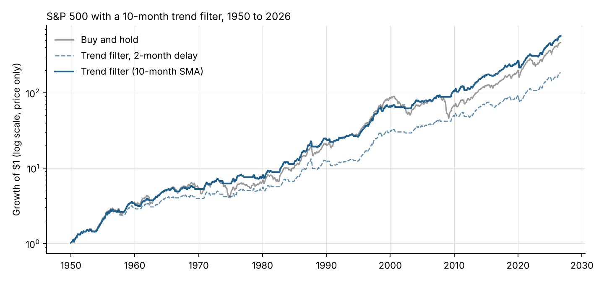
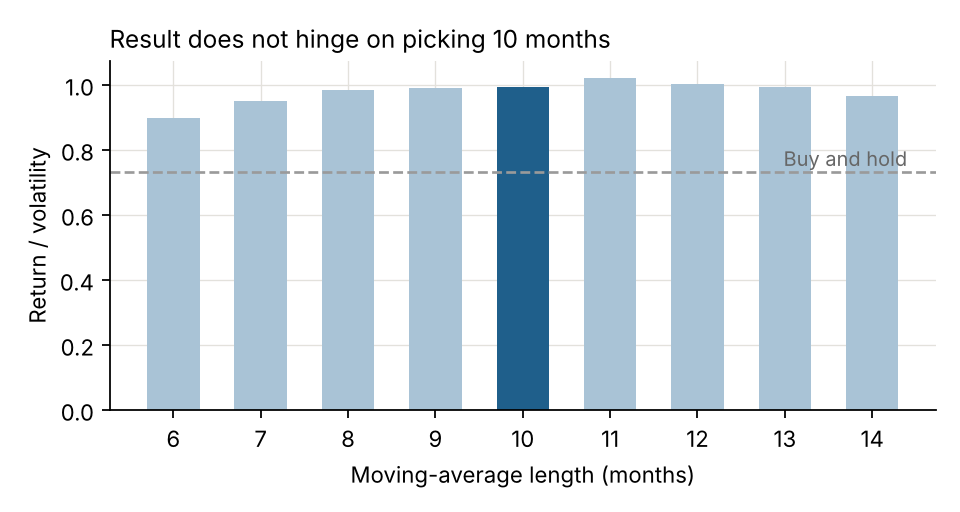
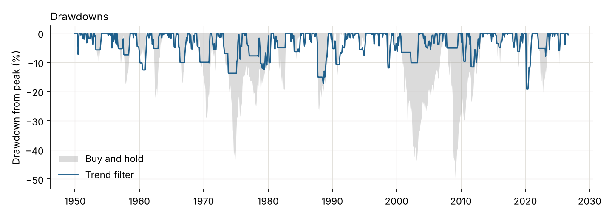

# S&P 500 Trend Filter Backtest (1950–2026)

Does a simple 10-month moving-average rule actually reduce the downside of holding the S&P 500, and does the result survive basic robustness checks?

**Rule.** At each month-end, hold the S&P 500 if its price is above its 10-month simple moving average; otherwise hold cash. The signal is acted on the *following* month, so there is no look-ahead, and every switch is charged 0.1%.



## Results (Jan 1950 – Sep 2026, monthly)

| Test | Strategy CAGR | Ret/Vol | Max drawdown | Buy & hold CAGR | Ret/Vol | Max drawdown |
|---|---|---|---|---|---|---|
| **Main: price return, trade next month** | 8.6% | 0.99 | −19.2% | 8.3% | 0.73 | −50.8% |
| Robustness: trade two months later | 7.0% | 0.81 | −27.3% | 8.3% | 0.73 | −50.8% |
| Robustness: incl. dividends, cash at 0% | 10.9% | 1.22 | −19.0% | 11.7% | 0.98 | −49.0% |
| 1950–2006 | 8.1% | 0.96 | −17.3% | 8.1% | 0.73 | −43.7% |
| 2007–today (after the rule was published) | 10.0% | 1.07 | −19.2% | 8.9% | 0.73 | −50.8% |

"Ret/Vol" is annualised return divided by annualised volatility. Cash earns 0%, so it is not a true Sharpe ratio.

**Main takeaways**

- Return is roughly the same as buy and hold; the benefit is risk. The worst drawdown falls from about −51% to between −19% and −27%, depending on how quickly the signal is acted on.
- The rule kept working after it was published (Faber, 2007), which is the closest thing this data has to an out-of-sample test.
- It does not depend on picking exactly 10 months: every length from 6 to 14 months beats buy and hold on return/volatility.



## Where it helped and where it did not

| Episode | Trend filter | Buy & hold |
|---|---|---|
| Dot-com, Sep 2000 – Sep 2002 | −10.1% | −41.6% |
| GFC, Nov 2007 – Feb 2009 | −5.0% | −47.7% |
| COVID, Feb – Mar 2020 | −19.1% | −19.1% |
| Rate shock, Jan – Sep 2022 | −5.2% | −17.6% |

A monthly signal cannot react to a crash that happens inside one month. COVID is the clearest example.



## Limitations, stated plainly

- **Monthly average prices.** Shiller's data uses the average of daily closes in each month, not month-end closes. Averaging smooths drawdowns and makes trends look more persistent, which flatters a trend rule. The two-month-delay test is a partial check on this; the honest range for the drawdown improvement is −51% to about −20–27%.
- **Cash earns nothing.** Using T-bill returns for the cash periods would raise the strategy's return. Including dividends raises buy and hold more than the strategy, because the strategy is only invested about 72% of the time.
- **Dividends after mid-2023.** The dataset's dividend column ends in June 2023; the dividends-included test carries the last value forward. The main test uses price only for both sides, so it is unaffected.
- **No taxes.** In a taxable account, about 1.3 switches per year would realise gains.
- **One market, one rule.** This is a single, well-known rule on a single index; it is a study of a risk-control idea, not a claim of alpha.

## Run it

```bash
pip install -r requirements.txt
python backtest.py            # uses the CSV in data/
python backtest.py --refresh  # re-downloads the latest data
```

Outputs `results/results.json` and the three charts in `charts/`.

## Data

Robert Shiller's monthly S&P 500 series, as packaged by [datasets/s-and-p-500](https://github.com/datasets/s-and-p-500) (Open Data Commons PDDL).

## Reference

Faber, M. (2007). *A Quantitative Approach to Tactical Asset Allocation.* The Journal of Wealth Management.

---

Hanyu (Lotus) Ke · MSc in Quantitative Finance, Singapore Management University · [LinkedIn](https://www.linkedin.com/in/hanyu-ke-lotus)
